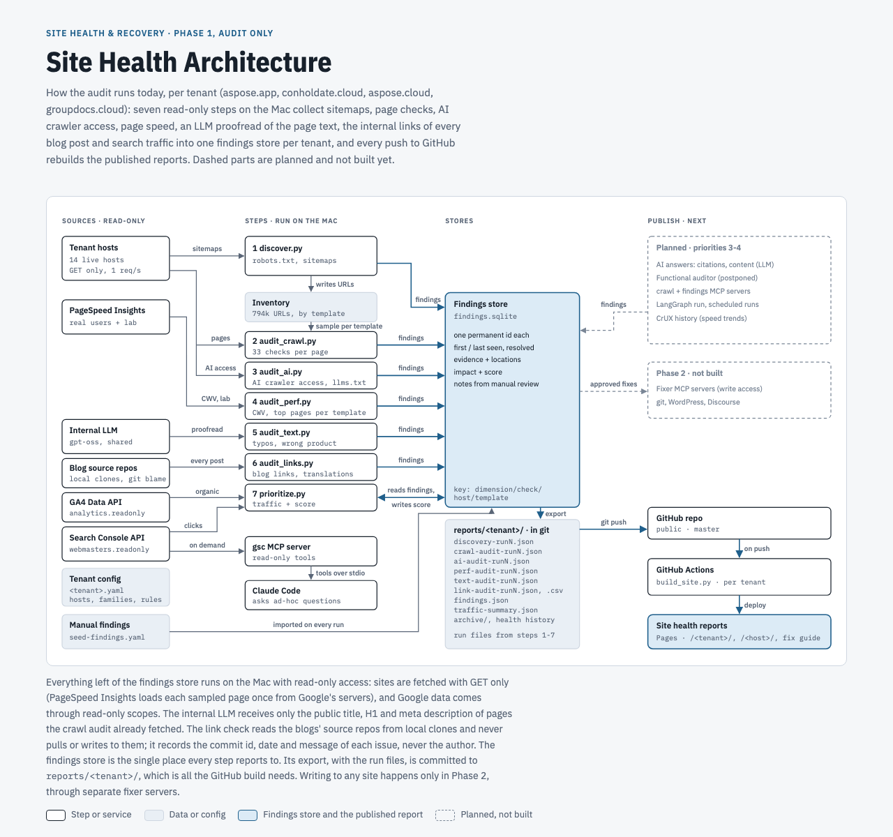

# Site Health & Recovery Agents

Domain-agnostic agents that audit a web property and report what is broken, not optimized, incorrect or improvable. Phase 1 is **audit only**. The project brief and rules are in [`CLAUDE.md`](CLAUDE.md).

## Latest reports

One report per tenant (property), listed on the [landing page](https://shoaibkhan-aspose.github.io/health-and-recovery/):

- **[aspose.app](https://shoaibkhan-aspose.github.io/health-and-recovery/aspose.app/)**: summary, product family and host health, priorities, shared problems, all findings (each linked to the fix guide), page speed (Core Web Vitals), AI readiness (AI crawler access, llms.txt), and changes since the last run. Previous versions: [archive](https://shoaibkhan-aspose.github.io/health-and-recovery/aspose.app/archive/).
- **[conholdate.cloud](https://shoaibkhan-aspose.github.io/health-and-recovery/conholdate.cloud/)**: blog.conholdate.cloud for now. Previous versions: [archive](https://shoaibkhan-aspose.github.io/health-and-recovery/conholdate.cloud/archive/).
- **[aspose.cloud](https://shoaibkhan-aspose.github.io/health-and-recovery/aspose.cloud/)**: blog.aspose.cloud for now, including the link check of every post. Previous versions: [archive](https://shoaibkhan-aspose.github.io/health-and-recovery/aspose.cloud/archive/).
- **[groupdocs.cloud](https://shoaibkhan-aspose.github.io/health-and-recovery/groupdocs.cloud/)**: blog.groupdocs.cloud for now, including the link check of every post. Previous versions: [archive](https://shoaibkhan-aspose.github.io/health-and-recovery/groupdocs.cloud/archive/).
- **[Fix guide](https://shoaibkhan-aspose.github.io/health-and-recovery/fix-guide/)**: one shared page for every report: what each check means, its impact, how to fix and verify it, and which reports have it open.

Each report grades product families and every host (A–F, out of 100). Every host also has its own page at the site root, e.g. [https://shoaibkhan-aspose.github.io/health-and-recovery/blog.conholdate.cloud/](https://shoaibkhan-aspose.github.io/health-and-recovery/blog.conholdate.cloud/) or [https://shoaibkhan-aspose.github.io/health-and-recovery/forum.aspose.app/](https://shoaibkhan-aspose.github.io/health-and-recovery/forum.aspose.app/): the property report filtered to that host, for the team that owns it. The header switches between properties and hosts.

[](https://github.com/shoaibkhan-aspose/health-and-recovery/actions/workflows/pages.yml)

The site (landing page, reports, host pages, archives, fix guide) is rebuilt by GitHub Actions (`scripts/build_site.py`) on every push to `master`, from the run files committed in `reports/<tenant>/`. Audits themselves run locally (see Setup). Links to the old address (`…/aspose-app-health-and-recovery/…`, before the repository was renamed) redirect here. All reports move to a private domain later.

## Architecture



Full page with the step-by-step table, design rules and code layout: [`docs/architecture/site-health-architecture.html`](docs/architecture/site-health-architecture.html) (also published as a private claude.ai page: https://claude.ai/artifact/3zrEcbrV1WxN9nfjvS7Kxm).

## Layout

```
core/          deterministic logic (no tenant names allowed)
mcp_servers/   MCP servers wrapping core (read-only in Phase 1)
agents/        LLM agents (LangGraph)
tenants/       one YAML per property: aspose.app, conholdate.cloud, aspose.cloud, groupdocs.cloud
scripts/       CLIs, e.g. check_access.py
tests/         offline tests
reports/       reports/<tenant>/: run JSON, findings.json, archive (committed; source of the published reports)
data/          data/<tenant>/: SQLite stores and caches (not in git)
```

## Setup (macOS)

```bash
python3 -m venv .venv && source .venv/bin/activate
pip install -e ".[dev,crawl]"
cp .env.example .env          # set the key path (quote it if it has spaces); the key file stays outside the repo
set -a; source .env; set +a
pytest                        # offline tests
# every script takes --tenant (or TENANT in the environment; default aspose.app)
python scripts/check_access.py --tenant aspose.app
python scripts/discover.py --hosts products.aspose.app --sections pdf,words   # sample
python scripts/discover.py                                                  # all hosts
python scripts/audit_crawl.py                                              # crawl audit; --sections a,b narrows products only
python scripts/audit_ai.py                                                 # AI readiness: AI crawler access, llms.txt (~5 min)
python scripts/audit_perf.py --plan                                        # speed audit: list the pages it would measure
python scripts/audit_perf.py                                               # speed audit via PageSpeed Insights (~40 min)
python scripts/audit_text.py                                               # text check: LLM proofreads titles, H1s, descriptions (~5 min)
python scripts/audit_links.py                                              # link check: every internal link of every post, from the blog's local repo (~20 min)
python scripts/prioritize.py                                               # Search Console traffic + score per finding
python scripts/build_report.py --out reports/aspose.app/discovery-latest.html --snapshot "After <run>"   # report + archive snapshot
python scripts/build_site.py --out site                                    # the Pages site: landing, tenant + host pages, fix guide
```

Each tenant keeps its files apart: `data/<tenant>/` (inventory, audit pages, findings store, Google and LLM caches; not in git) and `reports/<tenant>/` (run files, `findings.json`, traffic summary, health history, `archive/`; committed). GitHub Pages serves a landing page at the root and each tenant's report at `/<tenant>/` with its archive at `/<tenant>/archive/`; the old root links (`/#…`, `/archive/<date>/`) redirect to `/aspose.app/`. A tenant YAML can name its own key variable (`google_credentials_env`).

Findings from every run, plus the manual ones in `tenants/<tenant>.seed-findings.yaml`, are kept in `data/<tenant>/findings.sqlite` with permanent ids, first/last seen and resolved status (`python scripts/findings.py summary`). `scripts/build_report.py` turns the newest discovery, crawl-audit, speed-audit, AI-audit, text-check and link-check runs plus the store (or `--findings reports/<tenant>/findings.json`) into the HTML report.

The text check needs the internal LLM settings in `.env` (`PROFESSIONALIZE_*`, see `.env.example`; install with `pip install -e ".[llm]"`). It reads the crawl audit's pages, fetches nothing, caches answers per page text in `data/<tenant>/`, and drops reviewed false positives listed under `audit.text.ignore` in the tenant YAML.

The link check (`scripts/audit_links.py`) needs a host's source repo as `local_path` in the tenant YAML and a discovery run. It reads every post's Markdown from the local clone (read-only; pull it first) and checks each internal link on the live site: a target the sitemaps list exists, anything else is fetched once (200 = exists, 404/410 = missing). It reports links into translations that do not exist, damaged links, links to another language although a translation exists, broken links, posts missing some of the tenant's `translation_languages`, and unsupported languages in the sitemaps; `git blame` adds the commit (id, date, message; never the author). The full fix list is written to `reports/<tenant>/link-audit-<date>-run<id>-issues.csv`.

## MCP servers

`mcp_servers/gsc`: read-only Search Console tools (`list_properties`, `search_performance`, `page_performance`, `compare_periods`, `list_sitemaps`, `inspect_url`). Needs `pip install -e ".[mcp]"`. Registered for Claude Code in `.mcp.json`; approve it once when Claude Code starts. It reads the key path from `GOOGLE_APPLICATION_CREDENTIALS` or, if unset, from `.env`. Run by hand: `python -m mcp_servers.gsc` (stdio).

`discover.py` is read-only and polite (robots.txt respected, 1 request per host per second, QA hosts skipped). It walks robots.txt and sitemaps for every tenant host, stores the URL inventory in `data/<tenant>/inventory.sqlite` and writes a summary plus sitemap findings to `reports/<tenant>/discovery-<date>-run<N>.json`.

`check_access.py` is read-only. It reports which GSC properties the service account can read (with 28-day clicks, top pages and sitemap errors) and which hostnames GA4 tracks, then writes `reports/<tenant>/access-check-<date>.json`.
